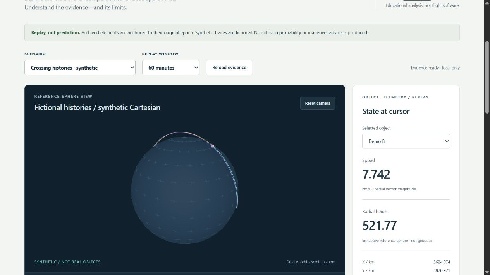

# Orbital Safety Workbench

Civilian orbit replay, transparent multi-object screening and reproducible scientific evidence. Created by **Jason Stys**.

[](https://github.com/JasonStys/orbital-safety-workbench/actions/workflows/validate.yml)
[](https://github.com/JasonStys/orbital-safety-workbench/actions/workflows/codeql.yml)

> Educational replay only—not navigation, flight software, collision-risk assessment or an operational safety tool. No targeting, intercept solver, destruction/fragmentation model or maneuver advice.



## What you can do

- Replay **archived ISS mean elements** at their May 2024 epoch with SGP4; never silently propagate stale elements to today.
- Explore **two fictional three-object histories**, including a closest approach between displayed sample timestamps.
- Orbit/zoom a 3D reference sphere, inspect an equal-scale XY projection, scrub/play time and select objects to inspect positions, speed and radial height.
- Search every piecewise-linear segment for each pair's minimum distance. **Collision probability is unavailable** because covariance and physical sizes are absent.
- Export JSON, unit-labeled CSV and inert HTML, including content-addressed run IDs and provenance. Optionally save immutable run evidence to a local SQLite history through the CLI.
- Run locally without accounts, API keys, external fonts, analytics, CDNs or remote data fetches.

## Quick start

Requires Python 3.12–3.14 and Node.js 24 for development. Run commands from the repository root. On Windows use `.venv/Scripts/python.exe`; on macOS/Linux use `.venv/bin/python` after creating the environment.

```sh
python -m venv .venv
# Activate using the standard command for your shell, or use the venv's Python path.
python -m pip install --require-hashes -r requirements.lock
npm ci
npm run build
python -m orbital serve
```

The service binds **only `127.0.0.1`** on an available port and opens your default browser. Keep its terminal open; Ctrl+C stops it. The browser view is responsive on small screens, but the local server runs on a desktop computer. It is not a public hosted website or a mobile-native installer.

Portable desktop bundles, when published, appear in [Releases](https://github.com/JasonStys/orbital-safety-workbench/releases). Extract the entire ZIP and launch `OrbitalSafetyWorkbench` (`.exe` on Windows). No Node/Python installation is needed for a bundle. These are **unsigned portable applications**, not notarized installers; do not bypass OS security warnings. See [installation and verification](docs/USER_GUIDE.md).

## Evidence without the UI

```sh
python -m orbital export --scenario synthetic-crossing --minutes 60 --format json --output evidence.json --history evidence.sqlite3
python -m orbital export --scenario iss-archive --minutes 30 --format html --output archived-iss.html
```

Existing export files are never silently overwritten. Only the CLI can write a history database; HTTP is read-only. Reports are deterministic across repeat runs with identical source/model/software inputs. Hashes identify content; they are not cryptographic signatures or proof of physical truth.

## Why these languages

| Component                  | Choice                                  | Responsibility                                                        |
| -------------------------- | --------------------------------------- | --------------------------------------------------------------------- |
| Scientific service and CLI | Python + the vetted SGP4 implementation | Epoch-safe propagation, numeric validation, exports and packaging     |
| Browser application        | Strict TypeScript + Three.js            | Typed view state, rendering, accessible controls and bounded playback |
| Evidence persistence       | SQL / SQLite                            | Atomic, parameterized, idempotent immutable history                   |
| Presentation               | HTML / CSS                              | Semantic help, responsive layout and restrictive same-origin assets   |

There is no unneeded language wrapper around the science engine. This is an engineering demonstrator, not a claim to implement a mission-qualified propagator.

## Repository map

| File / folder                        | Summary                                                                                                  |
| ------------------------------------ | -------------------------------------------------------------------------------------------------------- |
| `orbital/model.py`                   | Immutable sample/track contracts, bounded interpolation and continuous minima over sampled line segments |
| `orbital/scenarios.py`               | Reviewed catalog, ISS OMM propagation, synthetic fixtures, provenance and finite serialized cache        |
| `orbital/reports.py`                 | JSON/CSV/HTML export and transactional SQLite history                                                    |
| `orbital/server.py`                  | Loopback-only API, allowlisted assets, origin/Host checks and security headers                           |
| `orbital/__main__.py`, `launcher.py` | Source CLI, local website launcher and native application entry                                          |
| `orbital/resources/`                 | Public historical scientific fixture and history SQL schema                                              |
| `web/`                               | Semantic shell, styles, pure display utilities, typed state orchestration and disposable 3D renderer     |
| `tests/`                             | Numeric/reference/property, HTTP/security, CLI/history, TypeScript and cross-browser end-user tests      |
| `tools/`                             | Documentation inventory verification, native packaging and frozen-app smoke checks                       |
| `.github/`                           | Least-privilege pinned CI, CodeQL and manual draft-release automation                                    |
| `docs/`                              | Architecture, scientific method, user help, threat model, testing, validation, file/line catalogs        |

Every file is summarized in [FILE_CATALOG](docs/FILE_CATALOG.md). Source headers link to a generated [exact-line function/class/variable index](docs/CODE_INDEX.md), so line references are checked instead of copied into comments that become stale.

## Validation

```sh
python -m pip install --require-hashes -r requirements-dev.lock
python -m pytest --cov=orbital --cov-report=term-missing
python -m ruff check orbital tests tools launcher.py
python -m ruff format --check orbital tests tools launcher.py
python -m mypy orbital
python tools/verify_repo.py
npm run format:check
npm test
npm run build
npx playwright install --with-deps chromium firefox webkit
npm run test:e2e
python -m pip_audit --disable-pip --no-deps -r requirements-dev.lock
npm run audit
python tools/package_app.py
```

[Testing strategy](docs/TESTING.md) defines what these checks prove. [Validation results](docs/reports/VALIDATION.md) separates local observations, CI evidence and limitations. CI uploads **no Actions artifacts** and creates **no Actions caches** because account storage is constrained. Native downloadable ZIPs use separate GitHub Release storage only when explicitly dispatched.

## Documentation and contact

- [User guide](docs/USER_GUIDE.md) · [Science and data](docs/SCIENCE.md) · [Architecture](docs/ARCHITECTURE.md)
- [Security/threat model](docs/SECURITY.md) · [Testing](docs/TESTING.md) · [Release runbook](docs/RELEASE.md)
- Author/contact: [Jason Stys](https://github.com/JasonStys), [project issues](https://github.com/JasonStys/orbital-safety-workbench/issues). Please do not post private security information in public issues; use GitHub private vulnerability reporting when available.

MIT-licensed source; see [third-party notices](docs/THIRD_PARTY.md). No affiliation with a space agency or government organization is implied.
